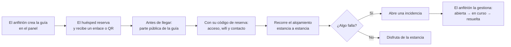
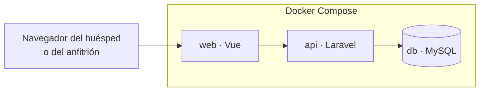

<p align="center">
  <picture>
    <source media="(prefers-color-scheme: dark)" srcset="docs/marca/atrio-logo-horizontal-blanco.svg">
    
  </picture>
</p>

<h3 align="center"><em>Entra antes de llegar.</em></h3>

<p align="center">
  La guía visual que enseña al huésped su alojamiento turístico, estancia a estancia, antes de que llegue.
</p>

<p align="center">
  
  
  
  
  
  
</p>

---

## El problema

Son las once de la noche. Un huésped acaba de llegar a un piso turístico del centro de Córdoba y no encuentra la caja de las llaves. Cuando por fin entra, el aire acondicionado no responde al mando y la vitrocerámica tiene un bloqueo que no sabe quitar. Escribe al anfitrión. El anfitrión, que gestiona otros diez pisos, contesta lo mismo que contestó ayer y antes de ayer.

En Córdoba hay **2.720 viviendas con fines turísticos**, el 91,5 % de todos los alojamientos de la ciudad (Registro de Turismo de Andalucía, diciembre de 2025). Casi ninguna tiene recepción. Y la normativa andaluza (Decreto 28/2016) obliga a tener a disposición del huésped las instrucciones de los electrodomésticos.

## La idea

**Atrio** convierte cada alojamiento en una guía web que el huésped recibe al reservar y recorre desde el móvil, sin instalar nada:

| | |
| --- | --- |
| **Llegada** | Cómo llegar, dónde aparcar y cómo entrar, con fotos del portal y de la puerta |
| **Recorrido** | El alojamiento estancia a estancia, avanzando con el scroll: qué hay en cada sitio |
| **Instrucciones** | Cada aparato con sus pasos e imágenes: el aire, la lavadora, la vitro, la tele |
| **Normas y entorno** | Normas de la casa, wifi, contactos y lugares de interés cercanos |
| **Incidencias** | Si algo falla, el huésped lo avisa desde la guía y sigue su estado |

El anfitrión lo mantiene todo desde un panel: lo actualiza una vez y todos sus huéspedes ven siempre la versión buena.

## Cómo funciona



### Quién hace qué

| Rol | Qué puede hacer |
| --- | --- |
| **Administrador** | Gestiona la plataforma y las cuentas de los anfitriones |
| **Anfitrión** | Crea y edita sus alojamientos, estancias, aparatos e instrucciones; gestiona reservas e incidencias. Solo ve lo suyo |
| **Huésped** | Entra con el código de su reserva. Ve los datos sensibles solo durante sus fechas y puede abrir incidencias |

### Arquitectura prevista



Un solo comando levantará todo el entorno: `docker compose up`.

## Hoja de ruta

| | Hito | Qué se entrega | Fecha |
| :---: | --- | --- | --- |
| 🟡 | **H0 · Propuesta validada** | Necesidad, análisis del sector, contexto profesional y guion de trabajo | 20 nov 2026 |
| ⚪ | **H1 · Diseño aprobado** | Requisitos, casos de uso, modelo de datos, prototipo y arquitectura | 14 dic 2026 |
| ⚪ | **H2 · Primera versión funcional** | Base de datos, API e interfaz funcionando juntas con Docker | 25 ene 2027 |
| ⚪ | **H3 · Producto mínimo desplegado** | Publicado en el servidor del centro, con pruebas y manual de usuario | 8 feb 2027 |
| ⚪ | **H4 · Entrega final** | Producto, manuales y memoria | 17 may 2027 |

Ahora mismo estamos en **H0**: todavía no hay código. Toda la documentación de la propuesta está en [`docs/H0/`](docs/H0/propuesta-h0.md).

## Estructura del repositorio

```text
.
├── docs/
│   ├── H0/                    Propuesta, guion de trabajo y tareas iniciales
│   ├── actas/                 Reuniones y entrevistas con anfitriones
│   ├── marca/                 Logotipo y recursos de la marca
│   └── declaracion-uso-ia.md  Uso declarado de inteligencia artificial
├── scripts/                   Utilidades para configurar el repositorio
├── .github/                   Plantillas de pull request e incidencias
├── CONTRIBUTING.md            Cómo trabajamos
└── LICENSE                    MIT
```

## Cómo trabajamos

Cada tarea nace en el tablero, se hace en su propia rama, se revisa en una pull request y entra en `main` solo con la aprobación de otro miembro del equipo. Usamos [Conventional Commits](https://www.conventionalcommits.org/es/v1.0.0/) y una versión etiquetada por hito. Todos los detalles están en [CONTRIBUTING.md](CONTRIBUTING.md).

## Equipo · Grupo 4

| | Rol | Se ocupa de |
| --- | --- | --- |
| **José Luis Martínez Fernández** | Director | Coordinación, calendario, tablero y relación con el profesorado |
| **Antonio Jesús Cejudo Valero** | Analista | Requisitos, casos de uso, diseño, pruebas y documentación |
| **Antonio Chacón Durán** | Desarrollador | Arquitectura, repositorio, integración y despliegue |

Proyecto Intermodular (módulo 0616) · 2.º de Desarrollo de Aplicaciones Web · Campus Córdoba · Curso 2026-2027.

## Licencia

El código se publica con licencia [MIT](LICENSE). El nombre «Atrio» y su logotipo son una propuesta del proyecto académico y no están registrados. Todos los datos de la aplicación serán ficticios.
