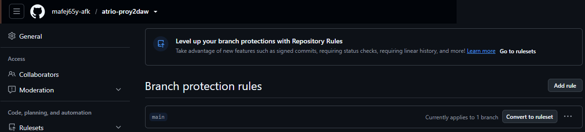
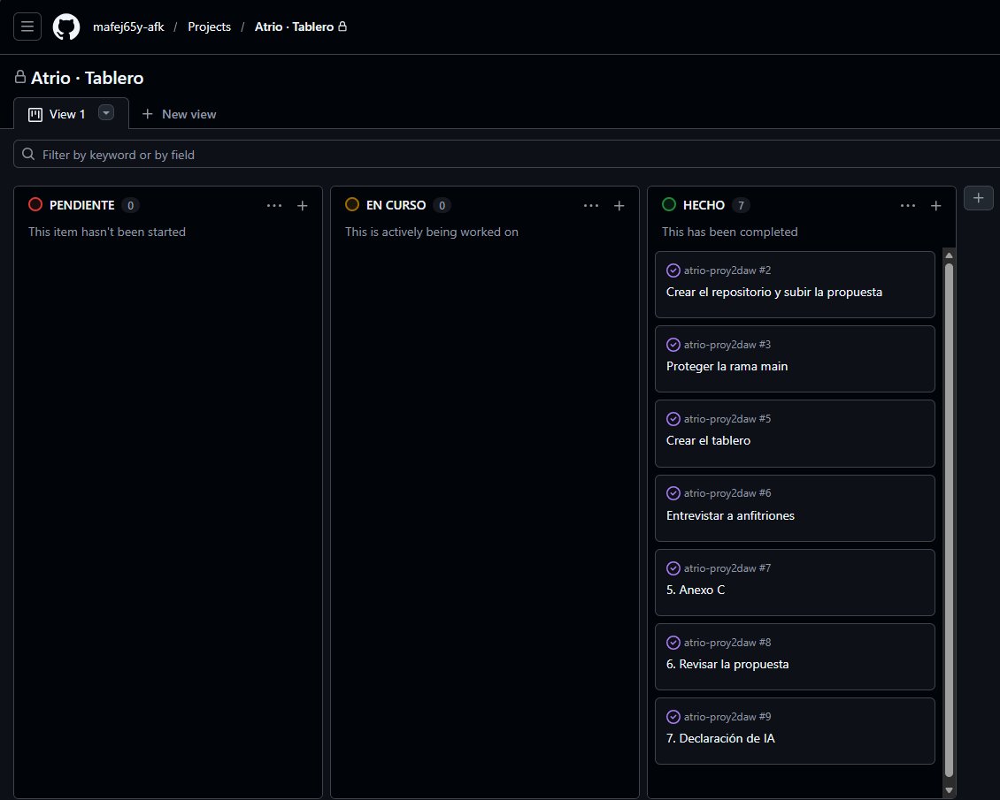

# La propuesta en dos minutos

**Qué problema resolvemos.** Córdoba tiene unas 2.700 viviendas turísticas. Sus anfitriones responden una y otra vez las mismas preguntas: cómo se entra, dónde se aparca, cuál es el wifi, cómo funcionan el aire acondicionado o la vitrocerámica. Además, la normativa andaluza les obliga a tener a disposición del huésped las instrucciones de los electrodomésticos. Hoy lo resuelven con mensajes sueltos, PDF o carpetas impresas.

**A quién ayudamos.** A propietarios y gestoras de viviendas y apartamentos turísticos de Córdoba y, a través de ellos, a sus huéspedes.

**Qué construimos.** **Atrio**, una aplicación web en la que cada alojamiento tiene su guía visual. El huésped la recibe al reservar y recorre el alojamiento estancia a estancia al hacer *scroll* (desplazarse por la página): cómo llegar y entrar, dónde está cada cosa y cómo se usa, normas y lugares de interés. Si algo falla, avisa desde la propia guía. El anfitrión lo gestiona todo desde un panel. Todo con Laravel, MySQL y Docker Compose, la pila del módulo.

> **Estado de la necesidad.** La necesidad se apoya en datos públicos, en la normativa y en una **primera entrevista presencial con una persona que gestiona un piso turístico en Córdoba** (17 de noviembre de 2026), que confirma el problema y considera útil la idea (apartado 3.3). En la semana S1 se entrevistará también a una gestora con varias viviendas.

# 1. Datos del proyecto y del equipo {.seguido}

| Dato | Valor | Estado |
| --- | --- | --- |
| Proyecto | Atrio — Guías visuales para alojamientos turísticos | Propuesta del grupo |
| Módulo | 0616 · Proyecto Intermodular · 2.º DAW · 70 h | Dato confirmado (guía del módulo) |
| Centro educativo | Campus Córdoba | Dato confirmado |
| Curso académico | 2026-2027 | Dato confirmado (guía del módulo) |
| Profesor | Pedro Díaz Majuelos | Dato confirmado (guía del módulo) |
| Equipo | Grupo 4 | Dato confirmado |
| Hito | H0 · Entrega E1 · Propuesta validada · 20 de noviembre de 2026 · 10 % del módulo | Dato confirmado (guía del módulo) |
| Repositorio | [github.com/mafej65y-afk/atrio-proy2daw](https://github.com/mafej65y-afk/atrio-proy2daw) | Dato confirmado |
| Versión del repositorio | `v0.1-propuesta` | Propuesta |

| Rol | Integrante | Responsabilidad principal (guía del módulo) |
| --- | --- | --- |
| Director | José Luis Martínez Fernández | Coordina al equipo, convoca reuniones, mantiene el tablero y el calendario, avisa de riesgos y habla con el profesorado |
| Analista | Antonio Jesús Cejudo Valero | Cuida los requisitos, los casos de uso y el diseño, y vela por las pruebas, la calidad y la documentación |
| Desarrollador (rol «Programador» de la guía) | Antonio Chacón Durán | Cuida la arquitectura, el repositorio, la rama principal, la integración y el despliegue |

Los roles son orientativos: los tres participamos en todo y los tres debemos poder explicar cualquier parte del proyecto.

# 2. Propuesta del proyecto

## 2.1 La necesidad

**Un mercado grande de alojamientos pequeños.** Según el Registro de Turismo de Andalucía, en diciembre de 2025 el municipio de Córdoba tenía **2.720 viviendas con fines turísticos (13.760 plazas)** y **54 establecimientos de apartamentos turísticos (1.443 plazas)**. Las viviendas turísticas son el 91,5 % de todos los alojamientos de la ciudad ([Diputación de Córdoba, balance turístico 2025](https://portal50.eprinsa.es/wp-content/uploads/2026/07/Balance_Turistico_1021_20260710_073540.pdf)). La mayoría las gestiona un particular o una gestora pequeña, sin personal de recepción.

**Una obligación que hay que cumplir.** El Decreto 28/2016 de viviendas turísticas de Andalucía exige, entre los requisitos de cada vivienda, tener a disposición de las personas usuarias información e instrucciones de funcionamiento de los electrodomésticos y otros dispositivos que lo requieran ([Junta de Andalucía, preguntas frecuentes](https://www.juntadeandalucia.es/export/drupaljda/FAQ_viviendasV4-1.pdf)).

**Un trabajo repetitivo.** **Supuesto para el proyecto:** cada huésped pregunta casi lo mismo antes y durante la estancia, y el anfitrión lo responde a mano por mensajería, a cualquier hora. Las guías en PDF o en papel se quedan desactualizadas y no enseñan dónde está cada cosa. La primera entrevista lo confirma: al llegar, los huéspedes preguntan sobre todo por el wifi, la calefacción y el agua caliente, y el anfitrión lo resuelve por mensaje, con bastante tiempo dedicado (apartado 3.3).

## 2.2 A quién ayuda

| Quién | Qué gana | Papel en el producto |
| --- | --- | --- |
| Propietario o gestora de viviendas y apartamentos turísticos | Menos mensajes repetidos, una guía siempre actualizada y una forma sencilla de cumplir el requisito de información | Cliente; gestiona sus alojamientos |
| Huésped | Llegar sabiendo cómo entrar y cómo funciona todo, con la información en el móvil | Usuario final |
| Atrio (nuestra empresa) | Un producto reutilizable para muchos alojamientos | Administra la plataforma |

## 2.3 El producto

Atrio es una aplicación web con tres partes:

1. **Guía del alojamiento.** Una página por alojamiento, pensada para el móvil:
    - *Llegada:* cómo llegar, aparcar y entrar.
    - *Recorrido visual:* el alojamiento estancia a estancia, avanzando con el scroll. En cada estancia se ven sus elementos (aire acondicionado, lavadora, vitrocerámica…) con instrucciones paso a paso e imágenes.
    - *Normas, wifi, contactos y lugares de interés cercanos.*
    - *Avisar de una incidencia:* el huésped comunica un problema y sigue su estado.
2. **Panel del anfitrión.** Alta y edición de alojamientos, estancias, elementos e instrucciones, reservas y lugares de interés; gestión de las incidencias.
3. **API propia.** Interfaz que conecta la guía y el panel con el servidor y la base de datos, con reglas de negocio y permisos por rol.

**Reglas de negocio principales (Propuesta).** La parte pública de la guía se puede compartir antes de reservar. Los datos sensibles (código de acceso, wifi, contacto directo) solo se muestran al huésped con una reserva activa y dentro de sus fechas. Cada anfitrión solo ve y gestiona sus alojamientos. Las incidencias pasan por los estados *abierta*, *en curso* y *resuelta*.

**Por qué una aplicación web (avance del criterio RA1.e).** El huésped no tiene que instalar nada: le llega un enlace o un código QR y lo abre en cualquier móvil. El anfitrión actualiza la guía una vez y todos los huéspedes ven siempre la versión al día.

**Modelo de negocio (Propuesta).** Cuota mensual por alojamiento, con un periodo de prueba. El importe se calculará en H1 junto con el presupuesto.

## 2.4 Alcance preliminar y requisitos mínimos del módulo

El alcance detallado se cerrará en H1. Esta tabla muestra cómo pensamos cubrir el alcance mínimo que exige el módulo.

| Requisito mínimo del módulo | Cómo lo cubre Atrio (propuesta preliminar) |
| --- | --- |
| Al menos 8 entidades relacionadas | Usuarios, roles, alojamientos, estancias, elementos, pasos de instrucciones, imágenes, lugares de interés, reservas e incidencias |
| 3 roles con permisos diferenciados | **Administrador** de la plataforma (Atrio) · **Anfitrión** (propietario o gestora: solo sus alojamientos) · **Huésped** (acceso con el código de su reserva: ve los datos sensibles en sus fechas y abre incidencias) |
| Autenticación y CRUD completo | Inicio de sesión de administradores y anfitriones; acceso del huésped por código de reserva; altas, consultas, cambios y bajas en alojamientos, estancias, elementos, instrucciones, reservas e incidencias |
| API propia | API REST en Laravel consumida por la guía y el panel |
| Al menos 10 casos de uso | Ver la guía pública, acceder con código de reserva, recorrer el alojamiento, consultar instrucciones de un elemento, abrir una incidencia, seguir una incidencia, gestionar alojamientos, gestionar estancias y elementos, gestionar reservas, resolver incidencias, gestionar anfitriones |
| Docker Compose, integración continua, despliegue | Base de datos, API y web en contenedores; GitHub Actions con pruebas y estilo en cada PR; despliegue en el servidor del centro |
| Calidad | WCAG 2.1 AA, diseño adaptable, seguridad básica OWASP, datos sintéticos con *seeders*, licencia libre |

**Queda fuera del producto mínimo:** cobros, conexión con plataformas de reserva o con sistemas de gestión de alojamientos, registro de viajeros ante la policía, cerraduras inteligentes, traducción a otros idiomas y asistente con IA.

**Pila prevista (se justificará en el estudio de viabilidad de E2).** Laravel y MySQL en el servidor, Vue en la interfaz y animación del recorrido ligada al scroll con imágenes fijas. El recorrido es un componente acotado: la prioridad del desarrollo es el modelo de datos, el panel y la API.

**Cambio respecto al borrador del 16 de noviembre.** La primera idea era una web para que los hoteles mostraran su edificio por plantas. La hemos simplificado porque en Córdoba los clientes con edificios de varias plantas son pocos (66 hoteles y 54 edificios de apartamentos) y porque la necesidad de las viviendas turísticas es más fácil de comprobar. Se mantienen la marca, la pila y el recorrido visual con scroll.

# 3. Análisis del sector

## 3.1 Clasificación de las empresas del entorno

**Clientes potenciales: la oferta de alojamiento del municipio de Córdoba (diciembre de 2025).**

| Tipología | Establecimientos | Plazas | Interés para Atrio |
| --- | ---: | ---: | --- |
| Viviendas con fines turísticos | 2.720 | 13.760 | Muy alto: sin recepción y con la obligación de informar sobre electrodomésticos |
| Apartamentos turísticos | 54 | 1.443 | Alto: varias unidades parecidas gestionadas por una misma empresa |
| Alojamientos rurales | 83 | 707 | Medio: mismas necesidades, llegada más difícil |
| Hostales y pensiones | 47 | 1.294 | Bajo: suelen tener recepción |
| Hoteles | 66 | 6.509 | Bajo: tienen recepción y personal |
| Campamentos y sin tipología | 3 | 446 | Bajo |
| **Total** | **2.973** | **24.159** | |

Fuente: Registro de Turismo de Andalucía, recogido en el [balance turístico 2025 de la Diputación de Córdoba](https://portal50.eprinsa.es/wp-content/uploads/2026/07/Balance_Turistico_1021_20260710_073540.pdf). Las plazas totales crecieron un 22,1 % respecto a diciembre de 2024.

Las viviendas turísticas se regulan en Andalucía por el Decreto 28/2016, modificado por el Decreto 31/2024. En los distritos Centro y Sur de Córdoba hay desde 2025 una moratoria de nuevas licencias de viviendas turísticas ([El Salto](https://www.elsaltodiario.com/cordoba/numero-pisos-turisticos-cordoba-se-reduce-tres-meses-moratoria-nuevas-licencias)): el mercado deja de crecer en número, y las viviendas que ya existen compiten más por la calidad del servicio.

**Mapa de empresas afines (clasificación propuesta).**

| Grupo | Qué tipo de empresas son | Relación con Atrio |
| --- | --- | --- |
| Clientes | Propietarios particulares con una o varias viviendas, gestoras de viviendas turísticas, edificios de apartamentos turísticos | Contratan el servicio |
| Competidores directos | Guías digitales para huéspedes (Touch Stay, Hostfully, Chekin) | Ofrecen una solución parecida |
| Competidores indirectos | Guías en PDF o en papel, mensajes automáticos de las plataformas de reserva | Resuelven parte de la necesidad |
| Colaboradores | Asociaciones del sector (por ejemplo, Avacor en Córdoba), fotógrafos de interiores, servicios de apoyo al emprendimiento (IMDEEC) | Aportan contactos, contenido o apoyo |
| Proveedores | Alojamiento web, dominios, herramientas de diseño | Necesarios para operar |

El **anexo C** recoge 12 empresas y entidades reales de Córdoba de estos grupos (gestoras, edificios de apartamentos turísticos, asociaciones y organismos de apoyo), con su fuente.

## 3.2 Empresa tipo

**Empresa tipo cliente (Supuesto para el proyecto): gestora pequeña de viviendas turísticas en Córdoba**, microempresa o autónomo que administra entre 5 y 30 viviendas de distintos propietarios, sobre todo en el centro.

| Área | Funciones | Relación con Atrio |
| --- | --- | --- |
| Dirección y captación de propietarios | Acuerdos con propietarios, precios, registro de las viviendas | Decide la contratación |
| Reservas y atención al huésped | Canales de reserva, mensajes, llegadas, dudas a cualquier hora | Principal usuaria del panel; es quien más ahorra |
| Limpieza y mantenimiento | Preparar las viviendas, reparar averías | Recibe las incidencias |
| Administración | Facturación, liquidación a propietarios, obligaciones legales | Paga el servicio |

Un **propietario particular** con una sola vivienda reúne todas estas funciones en una persona; por eso el panel debe ser muy sencillo.

**Empresa tipo propia (Propuesta): Atrio como microempresa de tres socios**, con áreas que se corresponden con los roles del equipo: dirección y gestión comercial (Director), análisis, diseño y calidad (Analista), y desarrollo, sistemas y despliegue (Desarrollador).

## 3.3 Necesidades más demandadas y validación

**Hipótesis de necesidades (Supuesto para el proyecto).**

1. Dejar de responder a mano las mismas preguntas de cada huésped.
2. Explicar bien la llegada y el acceso, sobre todo cuando no hay entrega de llaves en persona.
3. Tener las instrucciones de los electrodomésticos a disposición del huésped, como exige el Decreto 28/2016.
4. Mantener la información al día sin reimprimir ni reenviar documentos.
5. Enterarse rápido de las incidencias y saber cuáles están resueltas.

**Validación: primera entrevista realizada.** El 17 de noviembre de 2026, el Director entrevistó en persona a una persona particular que gestiona un piso turístico en Córdoba, con el guion del anexo A. El acta completa está en `docs/actas/2026-11-17-entrevista-anfitrion.md`.

| Necesidad (hipótesis) | Qué dijo la persona entrevistada | Resultado |
| --- | --- | --- |
| 1. Preguntas repetidas | Le preguntan por el wifi, la calefacción y el agua caliente, sobre todo al llegar; le quita bastante tiempo | Confirmada |
| 2. Llegada y acceso | Entrega las llaves en mano | No aplica en su caso; pendiente de comprobar con una gestora |
| 3. Instrucciones de aparatos | Las explica por mensaje; la calefacción es lo que más dudas genera | Confirmada |
| 4. Información actualizada | Necesitaría que la herramienta fuera sencilla y rápida de actualizar | Confirmada como requisito |
| 5. Incidencias | Los huéspedes le escriben o le llaman | Parcial: hoy lo resuelve por mensaje o teléfono |

No ha usado ninguna guía digital. Le pareció útil tener las instrucciones y las respuestas en un solo sitio, y acepta que le volvamos a contactar para enseñarle el prototipo.

**Qué cambia en el proyecto.** Las instrucciones de aparatos pasan a ser la parte prioritaria del MVP, y la sencillez del panel se convierte en un requisito de usabilidad para H1.

**Limitación y siguiente paso.** Es una sola entrevista a un anfitrión con un único piso. En la semana S1 entrevistaremos al menos a una gestora con varias viviendas (por ejemplo, a través de Avacor) y pasaremos la encuesta del anexo B.

## 3.4 Competencia

| Solución | Qué ofrece | Limitaciones frente a Atrio |
| --- | --- | --- |
| [Touch Stay](https://touchstay.com/es/digital-guidebook) | Guías digitales para alojamientos desde 2014, con aviso de incidencias, venta de extras, asistente con IA e integración con sistemas de gestión | Producto internacional y amplio; guía organizada por temas, no por recorrido visual del alojamiento |
| [Hostfully](https://www.hostfully.com/es/precios/guias-digitales/) | Guías digitales con plan gratuito y planes de pago por número de guías | Mismo enfoque por fichas de información |
| [Chekin](https://chekin.com/blog/guia-digital-para-huespedes/) | Guía digital unida al registro de viajeros | Centrado en el cumplimiento legal del registro |
| Guía en PDF o en papel | Gratis y funciona sin cobertura | Se desactualiza; no enseña dónde está cada cosa |
| Mensajes de las plataformas de reserva | Ya integrados en el canal de venta | Texto plano; solo para reservas de esa plataforma |

**Hueco que ocupa Atrio.** La competencia directa existe y es sólida, así que no buscamos ser los primeros. Atrio se diferencia en tres cosas: el **recorrido visual estancia a estancia** (dónde está cada cosa y cómo se usa, en lugar de una lista de fichas), el enfoque en el **requisito andaluz de instrucciones de electrodomésticos**, y un producto **sencillo, en español y cercano** para anfitriones de Córdoba.

## 3.5 Análisis DAFO

| | Favorable | Desfavorable |
| --- | --- | --- |
| **Interno** | **Fortalezas.** Roles complementarios. Pila conocida en el ciclo (Laravel y MySQL). Identidad de marca ya definida. Producto sencillo y reutilizable. Coste de herramientas casi nulo (software libre) | **Debilidades.** Sin experiencia comercial. Necesidad aún sin validar con anfitriones. La guía visual necesita buenas fotos de cada alojamiento. Tiempo limitado por el calendario del curso |
| **Externo** | **Oportunidades.** 2.720 viviendas turísticas en la ciudad. Obligación legal de informar sobre electrodomésticos. La moratoria del centro empuja a competir por calidad. Viajeros cada vez más acostumbrados a gestionar todo desde el móvil | **Amenazas.** Competidores consolidados con muchas funciones. Normativa cambiante y presión política sobre las viviendas turísticas. Anfitriones con poco presupuesto. Sin convocatoria abierta del Kit Digital a septiembre de 2026 ([OIE](https://www.oie.es/kit-digital-autonomos/)) |

# 4. Contexto profesional

## 4.1 Oportunidades

- Mercado local amplio: 2.720 viviendas turísticas y 54 edificios de apartamentos turísticos solo en el municipio de Córdoba, más los alojamientos rurales de la provincia.
- Necesidad ligada a una obligación: el requisito de información sobre electrodomésticos del Decreto 28/2016.
- Producto escalable: la misma plataforma sirve en cualquier destino de Andalucía y, con ajustes, en el resto de España.

## 4.2 Forma jurídica (Propuesta)

| Opción | A favor | En contra |
| --- | --- | --- |
| **Sociedad limitada (SL)** — recomendada | Responsabilidad limitada al capital aportado; imagen profesional; se puede constituir desde 1 € de capital desde la Ley 18/2022 «Crea y Crece» | Más trámites y contabilidad; con menos de 3.000 € de capital hay restricciones (reserva legal del 20 % del beneficio) |
| Tres autónomos con sociedad civil o comunidad de bienes | Trámites sencillos y baratos | Responsabilidad ilimitada de los socios |
| Sociedad laboral o cooperativa de trabajo | Ventajas para el empleo de los socios | Requisitos de constitución y gestión más exigentes |

Recomendamos una **SL de tres socios**: separa el patrimonio personal del de la empresa y da confianza a los clientes. Fuentes: [Legálitas](https://www.legalitas.com/actualidad/cerrar-sl-creada-con-1-euro), [Universidad Carlos III, guía de constitución de una SL](https://www.uc3m.es/uc3m/media/uc3m/doc/archivo/doc_guia-de-pasos-para-la-constitucion-de-una-sl/guia-basica-pasos-para-la-constitucion-de-una-sociedad-limitada.pdf).

## 4.3 Obligaciones fiscales

| Obligación | Cuándo | Detalle |
| --- | --- | --- |
| Alta censal en Hacienda (modelo 036) | Antes de empezar | Epígrafe del IAE (Impuesto sobre Actividades Económicas): para una sociedad que desarrolla software, grupo 845 «Explotación electrónica por cuenta de terceros» de la sección primera; un programador autónomo usaría el 763 de la sección segunda ([consulta DGT V2396-22](https://www.supercontable.com/informacion/IAE/Consulta_Vinculante_V2396-22.Epigrafe_para_creacion_y_.html)) |
| IVA (modelo 303 trimestral y 390 anual) | Cada trimestre | Las cuotas a los clientes llevan el 21 % de IVA |
| Impuesto sobre Sociedades (modelo 200 anual y pagos fraccionados 202) | Anual | Las sociedades de nueva creación tienen un tipo reducido en sus primeros ejercicios con beneficios; hay que confirmar el tipo vigente con una gestoría |
| Retenciones (modelos 111 y 190; 115 si se alquila local) | Si hay nóminas o alquiler | |
| Libros contables y cuentas anuales | Anual | Depósito en el Registro Mercantil |

## 4.4 Obligaciones laborales

- Los socios que trabajan en la empresa y la controlan cotizan como **autónomos societarios** en el RETA (Régimen Especial de Trabajadores Autónomos).
- Como nuevos autónomos pueden acogerse a la **cuota reducida («tarifa plana») de 80 € al mes** durante los primeros 12 meses, que en 2026 supone 88,64 € con el Mecanismo de Equidad Intergeneracional ([Declarando](https://declarando.es/darse-de-alta-como-autonomo/tarifa-plana-bonificaciones)).
- Si se contrata personal: inscripción de la empresa en la Seguridad Social, alta de cada persona trabajadora, contrato por escrito y aplicación del convenio colectivo del sector (previsiblemente, el de empresas de consultoría y tecnologías de la información; a confirmar).

## 4.5 Prevención de riesgos laborales

- La Ley 31/1995 de Prevención de Riesgos Laborales obliga a evaluar los riesgos, planificar la prevención y formar e informar a quien trabaje en la empresa, aunque sea pequeña.
- Riesgo principal: trabajo con pantallas de visualización (posturas, vista, fatiga), regulado por el Real Decreto 488/1997. Medidas: mobiliario adecuado, pausas y revisiones.
- Al trabajar en las viviendas de los clientes (fotos, revisión de instrucciones) hay que coordinarse con ellos en materia de prevención (Real Decreto 171/2004).
- En una microempresa, la prevención puede organizarse con un servicio de prevención ajeno.

## 4.6 Otras obligaciones que afectan al producto

- **Protección de datos (RGPD y LOPDGDD):** las reservas e incidencias contienen datos personales de huéspedes; hacen falta aviso de privacidad, contrato de encargado del tratamiento con cada anfitrión, conservación limitada y medidas de seguridad. En el proyecto solo usaremos datos ficticios generados por *seeders*.
- **Datos sensibles de acceso:** códigos de puerta y contraseñas de wifi solo se muestran a reservas activas y se tratan como información confidencial.
- **Servicios de la sociedad de la información (LSSI-CE):** aviso legal con los datos de la empresa y política de cookies.
- **Normativa turística de los clientes:** Atrio ayuda a cumplir el requisito de información del Decreto 28/2016, pero la responsabilidad sigue siendo del titular de la vivienda; lo diremos así en las condiciones del servicio.
- **Propiedad intelectual:** las fotos de cada alojamiento las aporta su anfitrión; en la demo usaremos imágenes con licencia libre o propias, registradas en un anexo.
- **Accesibilidad:** objetivo WCAG 2.1 AA, como exige el módulo.

## 4.7 Ayudas y financiación

| Ayuda | Para qué | Situación a noviembre de 2026 |
| --- | --- | --- |
| Cuota reducida de autónomos («tarifa plana») | Rebajar la cotización del primer año | Vigente |
| Cuota Cero y ayudas de inicio de actividad de la Junta de Andalucía (de 3.800 a 5.500 €) | Cubrir la cuota del primer año y apoyar el arranque | La convocatoria 2024-2026 cerró el 30 de septiembre de 2026 ([Billeo](https://www.billeo.es/alta-autonomo/andalucia)); vigilar una nueva convocatoria |
| Incentivos del IMDEEC (Ayuntamiento de Córdoba) | Autoempleo, emprendimiento y empleo joven en la ciudad | Convocatoria 2026 publicada en el BOP de 6 de mayo de 2026 ([BOP Córdoba](https://bop.dipucordoba.es/visor-pdf/06-05-2026/BOP-A-2026-1455.pdf)); revisar la de 2027 |
| Vivero de empresas Tecnocórdoba (IMDEEC) | Alojamiento gratuito para empresas nuevas | Disponible ([El Debate](https://www.eldebate.com/espana/la-voz-de-cordoba/actualidad/20250811/cordoba-cuenta-nuevo-espacio-acoger-nuevos-proyectos-emprendimiento_324822.html)) |
| ENISA Jóvenes Emprendedores | Préstamo participativo de 25.000 a 75.000 € para pymes jóvenes creadas por menores de 40 años | Línea permanente ([Infoautónomos](https://www.infoautonomos.com/ayudas-subvenciones-autonomos/enisa)) |
| Kit Digital | Bonos de digitalización para pymes | Sin convocatoria abierta a septiembre de 2026 ([OIE](https://www.oie.es/kit-digital-autonomos/)) |

# 5. Guion de trabajo hasta H1

## 5.1 Fases y fechas

Trabajaremos en **iteraciones de una semana** (Propuesta), con el tablero como referencia y una revisión breve al cierre de cada semana. Las fechas de entrega son las de la guía del módulo.

| Semana | Fechas | Objetivo | Entregables | Responsable principal |
| --- | --- | --- | --- | --- |
| S0 | 16 – 20 nov | Arranque y propuesta | Equipo y roles, repositorio con `main` protegida, README y licencia, tablero, esta propuesta. **20 nov: entrega E1 y etiqueta `v0.1-propuesta`** | Director |
| S1 | 23 – 27 nov | Validar la necesidad y recoger requisitos | Actas de entrevistas a anfitriones, resultados de la encuesta, requisitos funcionales y no funcionales, al menos 10 casos de uso o historias de usuario | Analista |
| S2 | 30 nov – 4 dic | Alcance y viabilidad | MVP justificado, estudio de viabilidad técnica y elección de la pila, recursos, presupuesto, modelo de precios y financiación | Director con el Analista |
| S3 | 7 – 11 dic (8 dic, festivo) | Diseño | Modelo de datos (al menos 8 entidades), 3 roles con permisos, prototipo en Figma o Penpot, diagrama de arquitectura, plan de calidad, manual técnico v0 | Analista y Desarrollador |
| Entrega | 14 dic | H1 · Diseño aprobado | **Entrega E2 y etiqueta `v0.2-diseno`** | Director |
| Revisión | 21 dic | Sesión de revisión del diseño con el profesorado | Comentarios recogidos en incidencias | Los tres |

## 5.2 Reparto de tareas por rol

| Tarea | Director | Analista | Desarrollador |
| --- | :---: | :---: | :---: |
| Propuesta y análisis del sector | **R** | C | C |
| Contexto profesional (legal, fiscal, ayudas) | **R** | C | |
| Repositorio, rama protegida, plantillas e integración continua | C | | **R** |
| Tablero y calendario | **R** | C | C |
| Entrevistas y encuesta | **R** | **R** | C |
| Requisitos y casos de uso | C | **R** | C |
| Viabilidad técnica y pila | C | C | **R** |
| Presupuesto, precios y financiación | **R** | C | C |
| Modelo de datos y roles | | **R** | C |
| Prototipo de la interfaz | C | **R** | C |
| Arquitectura y Docker Compose | | C | **R** |
| Plan de calidad y WCAG 2.1 AA | C | **R** | C |
| Revisión de pull requests | C | C | C |

**R:** responsable · **C:** colabora. Todas las PR las revisa al menos una persona distinta de quien las abre.

## 5.3 Forma de trabajo

- **Tablero Kanban** en GitHub Projects con las columnas *Pendiente*, *En curso*, *En revisión* y *Hecho*. Cada tarea es una incidencia (*issue*) con responsable.
- **Flujo en Git:** incidencia → rama por tarea → commits con Conventional Commits → pull request → revisión → merge a `main` → etiqueta por hito. Sin commits directos a `main`.
- **Comunicación:** canal del equipo; las decisiones y las actas se guardan en el repositorio (`docs/actas/`), porque el chat no cuenta como evidencia.
- **Seguimiento diario:** mensaje escrito de qué hice, qué haré y qué me bloquea (Propuesta).

# 6. Repositorio y tablero

| Elemento | Estado en la entrega |
| --- | --- |
| Repositorio en GitHub | Hecho: [github.com/mafej65y-afk/atrio-proy2daw](https://github.com/mafej65y-afk/atrio-proy2daw) |
| Rama `main` protegida (PR con al menos una revisión, sin excepciones para administradores) | Hecho el 18 de noviembre de 2026 (evidencias en el anexo F) |
| README y licencia (MIT) | Hecho |
| Guía para contribuir y plantillas de PR e incidencias | Hecho |
| Tablero con tareas y responsables | Hecho: tablero «Atrio · Tablero» en GitHub Projects, con las tareas del H0 como incidencias (copia en `docs/H0/tablero-inicial.csv`) |
| Etiqueta `v0.1-propuesta` | Se crea al aprobar la PR de la entrega |

# 7. Lista de comprobación del H0 {.seguido}

| Punto de la guía | Estado |
| --- | --- |
| Necesidad real descrita | Hecho (apartado 2) y contrastada con una primera entrevista (apartado 3.3) |
| Empresas tipo y departamentos caracterizados | Hecho (apartado 3.2) |
| Oportunidades y ayudas identificadas | Hecho (apartados 4.1 y 4.7) |
| Obligaciones fiscales, laborales y de prevención resumidas | Hecho (apartados 4.3 a 4.5) |
| Guion con fases y fechas hasta H1 | Hecho (apartado 5) |
| Repositorio con `main` protegida, README y licencia | Hecho (apartado 6 y anexo F) |
| Tablero con tareas y responsables | Hecho (apartado 6) |

# Anexo A. Guion de entrevista a un anfitrión o gestora de Córdoba

Duración prevista: 20 minutos. Pedir permiso para tomar notas y no recoger datos personales innecesarios.

1. ¿Cuántos alojamientos gestionas y de qué tipo? ¿Están en la misma zona?
2. ¿Cómo entregas las llaves o das acceso al huésped?
3. ¿Qué preguntas te repiten más los huéspedes, antes y durante la estancia?
4. ¿A qué horas te escriben? ¿Cuánto tiempo te lleva responder en una semana normal?
5. ¿Cómo das hoy las instrucciones de los electrodomésticos? ¿Papel, PDF, mensajes?
6. ¿Qué aparato o qué parte de la casa da más problemas a los huéspedes?
7. ¿Cómo te enteras de una avería o un problema? ¿Cuánto tardas en saberlo?
8. ¿Has usado alguna guía digital (Touch Stay, Hostfully u otra)? ¿Qué te pareció?
9. Mostrar el boceto de Atrio: ¿qué te resultaría útil y qué te sobra?
10. ¿Qué tendría que tener para que la usaras? ¿Podemos volver a contactarte para enseñarte el prototipo?

# Anexo B. Encuesta breve a personas que se han alojado en viviendas turísticas {.seguido}

1. ¿Cuántas veces al año te alojas en un piso o apartamento turístico? (ninguna / 1-2 / más)
2. ¿Has tenido problemas para entrar o para encontrar el alojamiento? (sí / alguna vez / no)
3. ¿Has tenido dudas sobre cómo usar algo del alojamiento (aire, vitro, lavadora, televisión)? (sí / alguna vez / no)
4. ¿Cómo te dieron la información? (mensajes / PDF / papel en el piso / nada)
5. ¿Te resultaría útil una guía en el móvil que te enseñe el piso estancia a estancia antes de llegar? (1 a 5)
6. Si algo se estropea, ¿cómo prefieres avisar? (mensaje al anfitrión / formulario en la guía / llamada)

La encuesta será anónima y no recogerá datos personales.

# Anexo C. Mapa de empresas de Córdoba {.seguido}

Empresas y entidades reales relacionadas con Atrio, comprobadas en fuentes públicas el 18 de noviembre de 2026. Cuando la fuente no indica el tamaño, se deja como «No consta».

| Empresa o entidad | Tipo | Tamaño aproximado | Relación con Atrio | Fuente consultada |
| --- | --- | --- | --- | --- |
| GuestReady | Gestora de alquiler turístico con servicio en Córdoba | Empresa internacional | Cliente potencial (gestora) | [guestready.com](https://www.guestready.com/es/gestion-alquiler-turistico/cordoba/) |
| Alquivir | Gestora de viviendas y apartamentos turísticos de Córdoba y provincia | Pequeña empresa local | Cliente potencial (gestora) | [alquivir.com](https://www.alquivir.com) |
| Genteel Home | Gestora con alojamientos turísticos en Córdoba | No consta | Cliente potencial (gestora) | [genteel-home.com](https://genteel-home.com/es/cordoba/alojamientos/apartamento-arruzafa-iv-cordoba) |
| Apartamentos Casa del Aceite | Apartamentos turísticos en una casa señorial del siglo XVIII, en el centro | 7 apartamentos | Cliente potencial (edificio de apartamentos) | [Cloudbeds](https://hotels.cloudbeds.com/en/reservation/ciw8r4) |
| Apartamentos Los Patios de la Judería | Apartamentos turísticos en la Judería | No consta | Cliente potencial (edificio de apartamentos) | [Turismo de Córdoba](https://www.turismodecordoba.org/ing-apartamentos-los-patios-de-la-juderia) |
| Apartamentos Alhajas de Córdoba | Apartamentos turísticos | No consta | Cliente potencial (edificio de apartamentos) | [Turismo de Córdoba](https://turismodecordoba.org/alhajas-de-cordoba-apartaments) |
| Apartamentos Céspedes Cinco | Apartamentos turísticos junto a la Mezquita-Catedral | No consta | Cliente potencial (edificio de apartamentos) | [Andalucía.org](https://www.andalucia.org/en/cordoba-acommodation-apartamentos-cespedes-cinco) |
| Apartamentos Córdoba Atrium | Apartamentos turísticos | No consta | Cliente potencial; nombre parecido al nuestro (ver nota) | [Turismo de Córdoba](https://www.turismodecordoba.org/cordoba-atrium-apartments) |
| Avacor | Asociación de Viviendas y Alojamientos Turísticos de Córdoba; agrupa sobre todo a pequeños propietarios, gestores y pequeñas empresas locales | Asociación | Colaborador: contacto con anfitriones para la validación | [El Debate](https://www.eldebate.com/espana/la-voz-de-cordoba/actualidad/20260704/guerra-desigualdad-trato-avacor-exige-moratoria-turistica-incluya-hoteles-apartamentos_435972.html) |
| AVVAPro | Asociación de Profesionales de Viviendas y Apartamentos Turísticos de Andalucía | Asociación regional | Colaborador | [El Debate](https://www.eldebate.com/espana/la-voz-de-cordoba/actualidad/20260327/cordoba-llega-semana-santa-oferta-3217-pisos-turisticos-16700-plazas_400389.html) |
| AEHCOR | Asociación de Empresarios de Hospedaje de Córdoba | Asociación | Colaborador (sector hotelero) | [Universidad de Córdoba](https://practicas.uco.es/sitcor/images/Conclusiones_resumen_I_Encuentro_CAPT.pdf) |
| IMDEEC | Instituto Municipal de Desarrollo Económico y Empleo de Córdoba | Organismo público | Apoyo al emprendimiento y ayudas | [BOP de Córdoba](https://bop.dipucordoba.es/visor-pdf/06-05-2026/BOP-A-2026-1455.pdf) |

**Nota sobre el nombre.** En Córdoba existen los «Apartamentos Córdoba Atrium», del mismo sector. No es el mismo nombre, pero conviene tenerlo en cuenta al comprobar la disponibilidad de la marca «Atrio» (anexo D).

# Anexo D. Identidad de la marca {.seguido}

El nombre, el eslogan («Entra antes de llegar») y el logotipo de Atrio son una propuesta del proyecto académico; antes de cualquier uso comercial hay que comprobar su disponibilidad en la OEPM, la EUIPO, dominios y redes sociales. El descriptor del logotipo pasa a ser «Guías visuales para alojamientos». Los archivos están en `docs/marca/`.

{width=60%}

# Anexo E. Declaración de uso de inteligencia artificial {.seguido}

Ver `docs/declaracion-uso-ia.md`. Resumen: se ha usado un asistente de IA (Claude, de Anthropic) para proponer la idea, el nombre y el logotipo, buscar y resumir fuentes públicas y redactar borradores de este documento y del repositorio. El equipo ha revisado el contenido, es responsable de él y debe poder explicarlo.

# Anexo F. Evidencias del repositorio {.seguido}

**Protección de la rama `main`.** Regla creada el 18 de noviembre de 2026 en *Settings → Branches*: exige pull request con una aprobación y no permite saltarse la regla, tampoco a los administradores.

**Tablero del proyecto.** Tablero Kanban «Atrio · Tablero» en GitHub Projects, con las columnas Pendiente, En curso y Hecho, el 18 de noviembre de 2026. Las tareas del H0 ya terminadas están cerradas en la columna Hecho.

{width=62%}

# Fuentes

- Diputación de Córdoba (Registro de Turismo de Andalucía). [Balance de la situación del sector turístico 2025](https://portal50.eprinsa.es/wp-content/uploads/2026/07/Balance_Turistico_1021_20260710_073540.pdf). Consultado el 18/11/2026.
- Junta de Andalucía. [Preguntas frecuentes sobre viviendas con fines turísticos](https://www.juntadeandalucia.es/export/drupaljda/FAQ_viviendasV4-1.pdf). Consultado el 18/11/2026.
- El Salto. [El número de pisos turísticos en Córdoba se reduce a los tres meses de la moratoria](https://www.elsaltodiario.com/cordoba/numero-pisos-turisticos-cordoba-se-reduce-tres-meses-moratoria-nuevas-licencias).
- Touch Stay. [Guía digital](https://touchstay.com/es/digital-guidebook).
- Hostfully. [Precios de las guías digitales](https://www.hostfully.com/es/precios/guias-digitales/).
- Chekin. [Guía digital para huéspedes](https://chekin.com/blog/guia-digital-para-huespedes/).
- Legálitas. [Sociedad limitada creada con 1 euro](https://www.legalitas.com/actualidad/cerrar-sl-creada-con-1-euro).
- Universidad Carlos III. [Guía básica para constituir una SL](https://www.uc3m.es/uc3m/media/uc3m/doc/archivo/doc_guia-de-pasos-para-la-constitucion-de-una-sl/guia-basica-pasos-para-la-constitucion-de-una-sociedad-limitada.pdf).
- Supercontable. [Consulta vinculante V2396-22 sobre el epígrafe del IAE](https://www.supercontable.com/informacion/IAE/Consulta_Vinculante_V2396-22.Epigrafe_para_creacion_y_.html).
- Declarando. [Tarifa plana para autónomos 2026](https://declarando.es/darse-de-alta-como-autonomo/tarifa-plana-bonificaciones).
- Billeo. [Alta de autónomo en Andalucía](https://www.billeo.es/alta-autonomo/andalucia).
- BOP de Córdoba. [Convocatoria de incentivos del IMDEEC 2026](https://bop.dipucordoba.es/visor-pdf/06-05-2026/BOP-A-2026-1455.pdf).
- El Debate. [Nuevo espacio del IMDEEC para emprendedores](https://www.eldebate.com/espana/la-voz-de-cordoba/actualidad/20250811/cordoba-cuenta-nuevo-espacio-acoger-nuevos-proyectos-emprendimiento_324822.html).
- Infoautónomos. [ENISA](https://www.infoautonomos.com/ayudas-subvenciones-autonomos/enisa).
- OIE. [Kit Digital 2026](https://www.oie.es/kit-digital-autonomos/).
- Guía del alumnado del Proyecto Intermodular, módulo 0616, curso 2026-2027.
